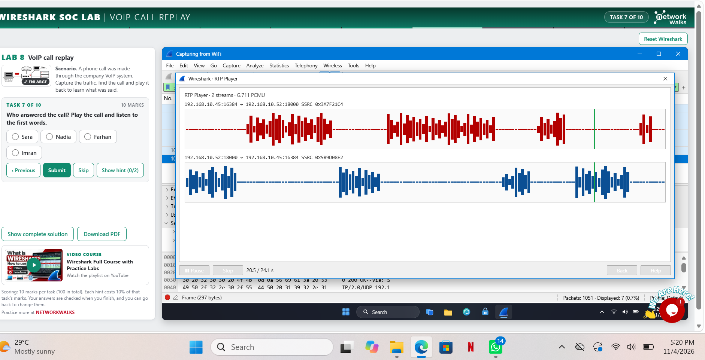

# 📡 Wireshark Network Traffic Analysis | Hands-on Labs

Exploring network traffic, capturing packets, and understanding how devices communicate through practical Wireshark exercises.

## 📌 Project Overview

This repository documents my hands on practice with **Wireshark**, an open-source network protocol analyzer used to capture, inspect, and analyze network traffic.

As part of my cybersecurity learning journey, I have been working through practical exercises to understand how network communication happens at packet level.

The labs involve examining captured traffic, applying display filters, identifying protocols and ports, and interpreting packet information to better understand network behaviour.

The goal is to move beyond networking theory and develop practical skills in network traffic analysis.

## 🎯 Project Objectives

- Understand how network packets are captured and analyzed.
- Identify different network protocols and their functions.
- Examine TCP communication and connection establishment.
- Identify source and destination IP addresses.
- Understand TCP ports and their associated services.
- Apply Wireshark display filters to isolate specific traffic.
- Explore protocol hierarchy and network statistics.
- Develop confidence in interpreting packet-level information.

## 🛠️ Tools & Technologies

| Tool | Purpose |
|---|---|
| Wireshark | Network packet capture and analysis |
| Windows 11 | Host operating system |
| Labs | Lab 3 - Lab 8 |

## 🔬 Practical Labs & Exercises

The following are the major areas explored during my Wireshark practice sessions.

### 1. Packet Capture & Traffic Inspection

- Capturing live network traffic.
- Identifying active network interfaces.
- Examining captured packets.
- Understanding packet details and protocol layers.
- Observing communication between network devices.

###  LAB 3: IDENTIFY THE ATTACKERS IP

- Identifying source and destination IP addresses.
- packets captured - 309
- opened ports answered the SYN with SYN, ACK. closed ports answered with RST,ACK.
- this was a port scan attack

### LAB 4: FOLLOW TCP STREAM 1
scenerio: A manager says some staff used an old office chat tool that sends messages in plain text. capture the traffic and use follow TCP stream to read the chat and see what was shared
# findings:
-most web traffic is port 80 and 443, the chat tool runs on tcp port 5000
the size of the conversation was 413 bytes
- The problem drive was a finance drive and the chat is readable by anyone on that network

### LAB 5: FOLLOW TCP STREAM 2
Scenerio: A staff member browsed the company intranet, and an admin thinks someone left a secret inside one of the web pages. captured the traffic and use follow TCP stream to find the hidden text.
# Findings
packet captured - 282
- The http filter found all the paged that was browsed, 5 pages were opened
- the notes was hidden on /staff.html, in stream 7
- The note was hidden in an HTML comment, it travelled from the server to client

### LAB 6: HTTP PLAIN TEXT CREDENTIALS
scenerio: An old staff portal still runs on plain HTTP. capture the traffic and find out what a person on the network can read from a sign in that is not encrypted
# FINDINGS:
-packets captured 255
-The sign in method used is POST
-There was 2 sign in attempt, the second one was successfull
-The HTML form URL encoded is where you find the username and password in the packet detail lines
-The fix is for the portal to run on HTTPS so that data will be encrypted

### LAB 7: CATCH THE BRUTE FORCE ATTACKER
 Scenario:  The FTP server owner reports many failed sign-ins in the last minutes. Capture the traffic, find who is guessing passwords and whether the attacker got in.

# FINDINGS:
packets captured : 369
The server was on the FTP protocol
ip address of FTP server: 192.168.10.20 while attackers ip : 192.168.10.66
the attacker kept trying to login with ther username ADMIN
The attacker kept getting the reply code 530 which means LOGIN INCORRECT and there was 24 failed logins displayed
There was 1 successful attempt and its code was 230, this attack is a brute force attack

### LAB 8: CATCH THE CALL SCAMMER
Scenario. A phone call was made through the company VoIP system. Capture the traffic, find the call and play it back to learn what was said.
# FINDINGS:
-packets captured:  1051
-The call was set up by the SIP
-RTP protocol carried the voice itself, as many small packets (804 was displayed)
-The codec that carried the voice PCMU
-I was able to listen in on the call and get sensitive information to fix this the company should encrypt calls using SRTP 

## 📊 Practical Skills Developed

Through these exercises, I have been developing practical skills in:

- Network packet capture.
- Network traffic inspection.
- TCP/IP analysis.
- Protocol identification
- using statistics to check conversations.
- Port identification.
- Wireshark display filtering.
- Network statistics and protocol hierarchy.
- Basic network troubleshooting.

## 💡 Key Learnings

Working through these labs has helped me understand networking concepts beyond what I initially learned in theory.

Some important takeaways include:

- Network communication becomes easier to understand when examined packet by packet.
- TCP flags provide useful information about connection establishment and communication.
- Ports help distinguish between different network services.
- Display filters make it easier to investigate specific traffic within large packet captures.
- Protocol Hierarchy provides a useful overview of the protocols present in a capture.
- Packet analysis requires observation, patience, and attention to detail.

## 👩‍💻 Author

**Favour**

Cybersecurity Learner | Aspiring Cybersecurity Professional

Currently building practical knowledge in cybersecurity, networking, Linux, and network traffic analysis.

---

*This repository documents my ongoing practical learning with Wireshark. It will continue to grow as I complete more exercises and develop my network analysis skills.*
